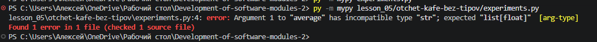
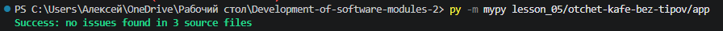
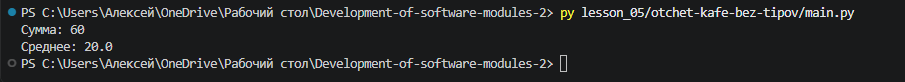

# Отчет по домашнему заданию № 5. Проверка типов до запуска

**Выполнил(а):** Гурняк Александра

## 1. Настройка проверки в VS Code

В настройках VS Code (`settings.json`) я установила `"python.analysis.typeCheckingMode": "basic"`. Это включает базовую проверку типов Pylance прямо в редакторе. Также я установила библиотеку `mypy` и запускала проверку через терминал.

## 2. Создание файла с неверными вызовами

Я создала файл `experiments.py`, в котором передала строку в функцию, ожидающую список чисел. В терминале `mypy` выдал следующую ошибку:

```text
error: Argument 1 to "average" has incompatible type "str"; expected "list[float]"




**Разбор ошибки:** Проверка типов сообщает, что я передала строку (`str`) туда, где ожидается список чисел (`list[float]`). Это помогает найти ошибку до запуска программы, когда она могла бы привести к сбою.

## 3. Доведение проекта до чистой проверки

После добавления аннотаций типов во всех функциях, команда `mypy app` выдала сообщение об успешной проверке:



Вывод программы после исправлений:



```text
Сумма: 60
Среднее: 20.0

## 4. Выводы

научилась настраивать статическую проверку типов с помощью Pylance и mypy. Теперь я понимаю, как аннотации типов помогают находить ошибки до запуска кода и делать программы надёжнее.