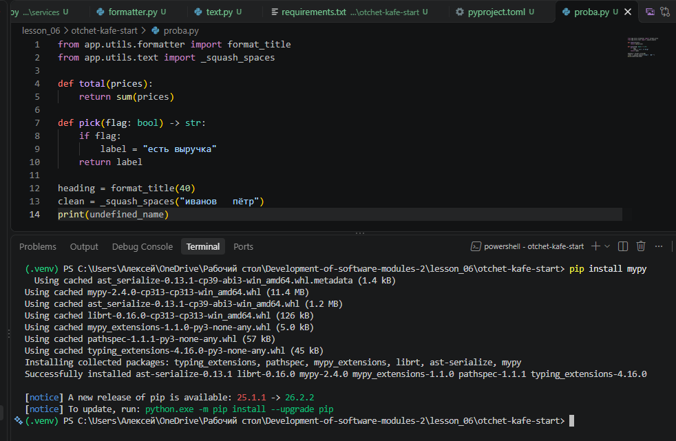
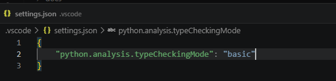
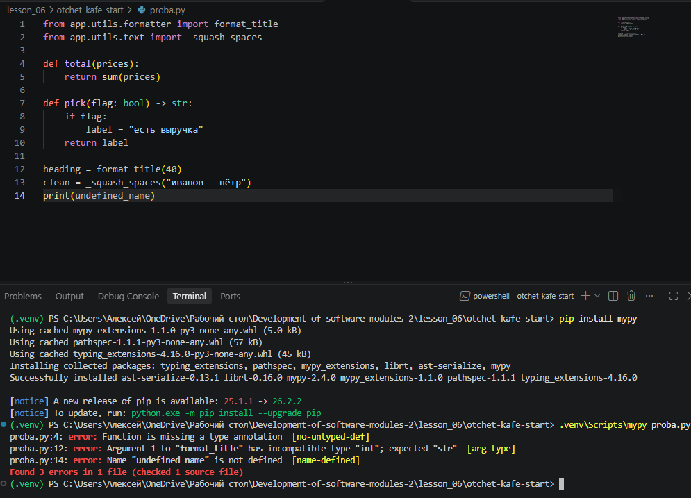
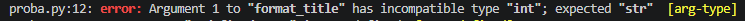
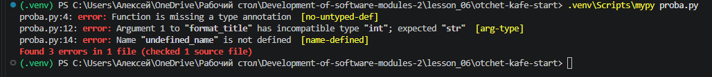
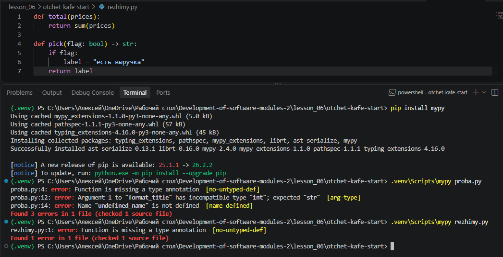
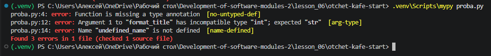
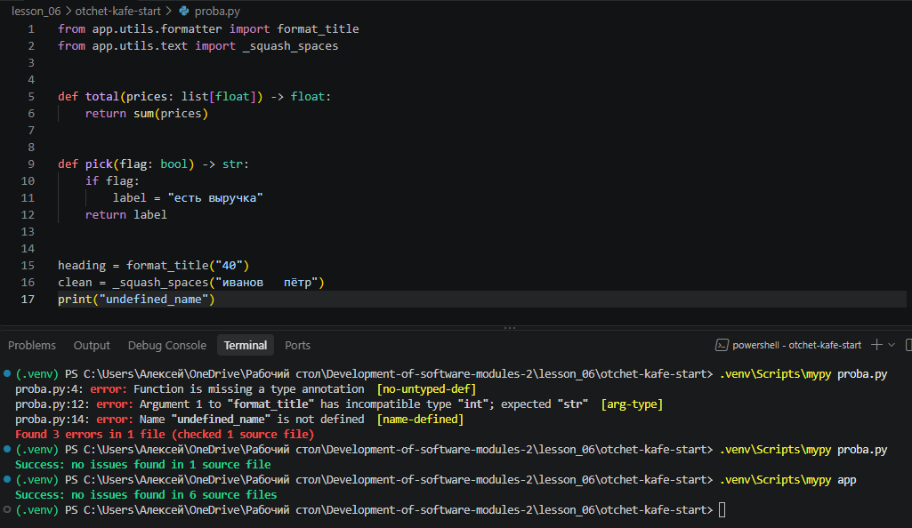
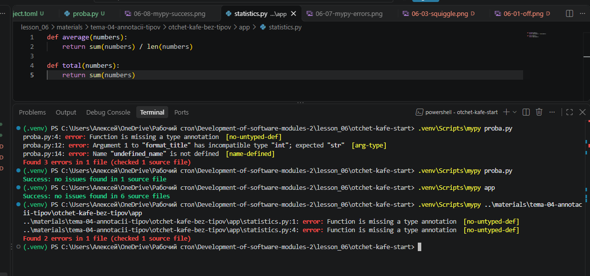
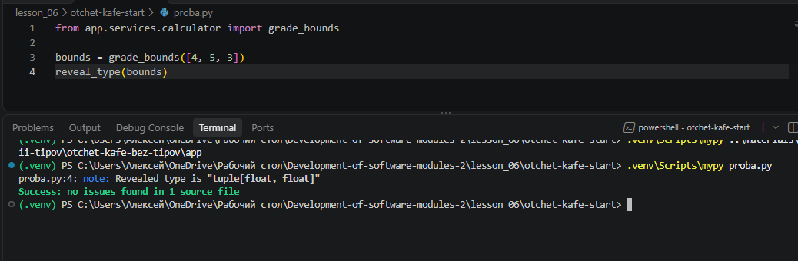

# Отчёт · Проверка типов: Pylance и mypy

**Студент:** Гурняк Александра, 9/2 РПО 25/3
**Номер в журнале:** 1, вариант шага 4: 1

Работа выполнена на втором архиве проекта «Отчёт кафе»
(`lesson_06/otchet-kafe-start`), глава 4.3.

## 1. Редактор до настройки

В корне проекта создан файл `proba.py` с двумя неверными вызовами:
`format_title(40)` и `format_kopeks("1250")`. Выбран интерпретатор
из окружения проекта, внизу справа окна написано `.venv`.

В режиме `off` в файле подчёркнуто 0 аргументов. Ошибки типов в этом
режиме не показываются, аннотации идут только в подсказки.

## 2. Включение режима basic

Настройка `python.analysis.typeCheckingMode` выбрана на вкладке Workspace,
поэтому VS Code записал её в файл `.vscode/settings.json` внутри проекта.

## 3. Ошибки в редакторе

После смены режима в `proba.py` подчёркнуты `40` и `undefined_name`. На вкладке
после имени файла стоит цифра 3.

Сообщение над `40`:

Pylance называет тип переданного значения `int`. Параметр `text`
функции `format_title` ожидает тип `str`. Правило, по которому
выдано сообщение, называется `arg-type`.

## 4. Моя ошибка и панель Problems

Мой вариант — 1. В `proba.py` добавлен вызов `print(undefined_name)`, он стоит
в строке 14. Функция объявлена в модуле `__main__`, её подпись:
`undefined_name`.

В панели Problems у `proba.py` 3 ошибки. Моя ошибка стоит
на месте `[Ln 14, Col 7]`, её короткая причина в конце сообщения:
`[name-defined]`.

## 5. Четыре режима на одном файле

Файл `rezhimy.py` проверен во всех четырёх режимах.
Число сообщений в панели Problems:

| Режим | Сообщений |
|---|---|
| `off` | 0 |
| `basic` | 1 |
| `standard` | 1 |
| `strict` | 1 |

Только в `standard` и `strict` появилось сообщение про переменную
`label`: `name-defined`. После опыта возвращён режим `basic`.

## 6. Ошибки в терминале

Версия mypy: `mypy 2.4.0`. Команда `mypy proba.py` закончилась строкой
`Found 3 errors in 1 file (checked 1 source file)`.

Строка с моей ошибкой: `proba.py:14: error: Name "undefined_name" is not defined  [name-defined]`.
В сообщении mypy параметр назван `undefined_name`, а Pylance называл его так же.

## 7. Исправление

Исправленные вызовы:

| Было | Стало |
|---|---|
| `format_title(40)` | `format_title("40")` |
| `format_kopeks("1250")` | `format_kopeks(1250)` |
| `print(undefined_name)` | `print("undefined_name")` |

После сохранения файла проверка повторена.

`mypy proba.py`: `Success: no issues found in 1 source file`.
`mypy app`: `Success: no issues found in 6 source files`.

## 8. Проект без аннотаций

На первом архиве mypy вывел `Found 2 errors in 1 file`.
У всех ошибок код `no-untyped-def`. Ошибки появились потому, что в `pyproject.toml`
включён параметр `disallow_untyped_defs = true`.

Первая строка списка: `statistics.py:1: error: Function is missing a type annotation [no-untyped-def]`.

## 9. Какой тип видит проверка

Pylance при наведении на `bounds` показал `tuple[float, float]`. mypy в строке
`reveal_type` вывел `tuple[builtins.float, builtins.float]`.

## 10. Итог

Если Pylance ошибок не показывает, а mypy показывает, первым делом
проверяю, выбран ли правильный интерпретатор `.venv`.

Не получилось: заставить Pylance подчеркивать ошибки в редакторе, поэтому использовала mypy в терминале.

ИИ: не использовался